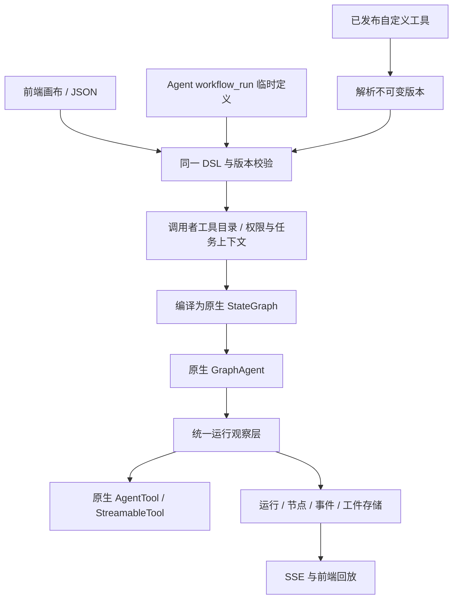

# ScopeForge 工作流设计

状态：分阶段设计记录。初始基线为 `experiment/graph-flow-tools` 分支 `8d647a3`；后续核心生命周期、统一目录、HTTP 工件和原生并行子图已实现，当前可用能力和操作方式以 [README.md](README.md) 为准。本文保留了 checkpoint、循环、Agent 节点等长期设计，不表示这些扩展已经接入。

## 1. 结论与目标

工作流可以补上 `http_request` 与其他工具之间的数据组合能力：HTTP 返回值可以传给 JSON 解析、文本提取、另一个 HTTP 请求、命令行 stdin 或文件参数；整个组合又可以作为工具调用。用户和 Agent 无须反复把响应复制进下一次提示词。

要实现这一点，需要同时补全结构化输出、完整正文/文件引用、通用工具接入和执行记录。只增加画布或 `$ref`，仍不能可靠实现类似 `curl | jq | other-tool` 的效果。工作流定义的是节点间输入输出；任意 shell 字符串、交互终端和无限字节流继续由已有 Bash/交互工具处理。

产品提供三种使用方式，共用同一份 DSL、编译器、原生执行内核和运行记录：

| 方式 | 创建者及入口 | 可重复使用 | 是否进入自定义工具列表 |
| --- | --- | --- | --- |
| 临时流程 | Agent 调用 `workflow_run`，传入流程定义和输入 | 可以从运行记录“另存为工作流” | 否 |
| 已保存工作流 | 前端编排；或 Agent 经现有平台操作能力保存草稿 | 通过工作流 ID 试运行 | 否，直至发布 |
| 已发布工作流工具 | 在工作流中发布固定版本 | 以 `flow_<name>` 调用 | 是，类型为 `workflow` |

“临时”指不进入可复用工作流目录，也不增加工具注册项。它的定义快照、执行过程、输入输出仍然落盘，不能退回到只有内存过程的状态。

## 2. 当前证据与缺口

已实现：原生 `MessagesStateSchema`、`AddNode`、`AddToolsNode`、`AddConditionalEdges`、GraphAgent、原生 AgentTool 的内层事件转发；开始/工具/条件/结束；可视化编辑；草稿与发布快照；SQLite 运行记录和带游标 SSE；CLI 结构化适配示例。

已有测试覆盖原生父 Agent 调用 Flow、事件转发、参数错误、并发运行隔离、取消、发布快照隔离、SSE 在运行中到达及持久化回放。`test2` 的配置和页面展示已验证，四个实际 CLI 没有扫描验证，不能据此声称任意 CLI 环境已经兼容。

当前确定存在的缺口：

1. `http_request` 对外是 `toolkit.Output.Text`，内容为元信息加正文；`netrequest.Output.Body` 是最大 16 KiB 展示预览。完整采集上限 8 MiB，不等于完整正文已向工作流暴露。不能解析展示文本冒充稳定数据协议。
2. `flowTools` 动态注册工具，但没有 tools 表记录；现有自定义工具页无法显示、停用和管理这些 Flow。Agent 直接调用发布工具也没有统一经过试运行的记录路径。
3. 临时定义目前只在编译器层可行，没有 Agent 调用入口；`flow_runs.flow_id NOT NULL` 也不允许独立的临时运行。
4. 目录仅支持固定的网络工具和几种 CLI，尚未统一调用自定义工具、MCP、技能可见工具。
5. 当前共享 `flow_steps` 使用整体替换 reducer，工具节点共享 `messages` 和 `last_tool_response`。不能直接加两条并行边宣称工具并发已正确。
6. 目前事件只保存节点名称、开始/结束和错误，缺少节点输入输出、重试次数、原生事件载荷和父子调用关联。
7. 当前仅保留最近一次发布快照，没有发布版本历史、下架和回滚；运行落盘也不是原生 checkpoint。

本轮新增 `internal/flowproto/design_probe_test.go` 做两类运行验证与一个边界验证：本地 HTTP 的结构化结果经过现有原生 GraphAgent/AgentTool 进入下一工具；原生 fan-out / AddJoinEdge 等待两个分支且保留独立状态；确认较大 HTTP 正文的展示预览不能作为完整管道输入。HTTP 探针使用测试适配器，尚未修改生产 `http_request` 的返回契约。并行探针验证普通原生节点，不代表并行工具子图已经验收。

## 3. 执行架构



实现一个 WorkflowService，提供 Validate、Save、Publish、Start、GetRun、Cancel 等业务入口。执行、分支、并发、重试、子图和 checkpoint 均交给 tRPC-Agent-Go。WorkflowService 负责定义校验、权限解析、调用上下文、数据适配、版本与运行持久化；不实现自己的调度循环。

工具调用统一构造为：编译得到 GraphAgent → 观察层包装该 Agent 的 Run → 原生 `agenttool.NewTool`。观察层先记录原生事件，再向父调用转发，保持原生事件身份和关联信息。试运行、临时调用、发布工具调用均走这条路径，避免“前端能看过程，Agent 调用却没有记录”。包装器必须保留 StreamableTool、结构化流错误和其他原生接口能力。

前端关闭 SSE 只关闭订阅，不停止运行。Agent 同步调用被取消、任务被停止或运行超时，则沿同一个 context 取消原生执行与宿主进程。前端 Start 创建后台运行，但仍绑定所属任务取消源及服务生命周期；后台运行不能因采用 `context.Background()` 而丢失任务归属。

## 4. DSL、节点与版本

增加 `schema_version`，与用户草稿 `revision`、不可变发布 `version_id` 分开。旧 DSL 通过明确的 v1→v2 转换继续读取，既有 test2 不需要手工重建。

节点保留稳定 `id`，单独使用 `label` 展示名字；连线使用独立 edges，画布位置放在 ui 字段。模型输入可以省略 ui。最终执行以冻结后的语义定义及 hash 为准，拖动节点不会改变已发布语义版本。

| 节点 | 用途 | 原生映射与约束 |
| --- | --- | --- |
| start | 输入 Schema、运行输入 | AddNode，校验并写入独立输入状态 |
| tool | 任意已授权 CallableTool | 原生工具子图中的参数准备 → AddToolsNode → 结果归一化 |
| transform | JSON 解析、取字段、合并、去重、文本行、编码等 | AddNode，确定性函数；操作名白名单，无 eval |
| condition | 基于结构化值路由 | AddConditionalEdges；支持 eq/ne/exists/in/比较和有限布尔组合 |
| parallel / join | 有边界的分叉、全部汇合 | AddEdge / AddJoinEdge，加独立子图状态 |
| foreach | 对有限数组执行工具或子流程 | 第二阶段才接入；选定并验证 SDK 原生实现后开放 |
| agent | 需要模型判断/生成的步骤 | AddAgentNode / AddSubgraphNode；显式模型、允许工具和调用预算 |
| workflow | 固定版本的子工作流 | 原生子图；显式 I/O 映射，禁止依赖环 |
| end | 输出 Schema 和结果映射 | AddNode，校验最终输出 |

第一阶段开放 start/tool/transform/condition/end，第二阶段开放经过隔离验证的并行/子流程/Agent，第三阶段开放有界 foreach、checkpoint 和人工中断。前端只展示当前可执行的节点；不提供看似可用却无法运行的控件。任意循环不在首期范围，后续必须有最大迭代数和总预算。

引用是数据对象，不是字符串插值。v2 使用 JSON Pointer，例如 `{"$ref":"#/steps/fetch/data/status_code"}`；数组索引、带点的 JSON key 都可明确表达。继续兼容现有 `input.domain / steps.merge.subdomains` 引用，但新建流程只写 v2。缺失字段默认报错，只有显式设置默认值/可选引用才能继续；分支未执行的输出不会自动变成空字符串。

编译校验：定义大小/节点数、唯一 ID、入口/出口、可达性、Schema、工具存在与授权、类型兼容、引用来源是否必然在当前路径前完成、条件所有出口、输出契约、循环/子流程递归、汇合可达性。分支的互斥路径不能直接接 `all_of` 汇合；应先合为一个明确出口，否则会永远等待未执行路径。运行前再次校验实际输入，工具调用前再次校验已解析参数。

v2 定义至少包含 schema_version/name/input_schema/output_schema/entry/nodes/edges，可选 ui 与 limits。下面是拟定契约示例，用于说明完整数据引用；不是当前 v1 API 已支持的可执行文件。示例假定响应为小型、完整的 UTF-8 JSON，具有 hosts 数组；大响应改为显式 artifact 输入，缺字段/不完整响应按错误路径处理。

```json
{
  "schema_version": 2,
  "name": "http_hosts",
  "input_schema": {"type":"object","required":["url"],"properties":{"url":{"type":"string"}}},
  "output_schema": {"type":"object","required":["hosts"],"properties":{"hosts":{"type":"array","items":{"type":"string"}}}},
  "entry": "begin",
  "nodes": [
    {"id":"begin","type":"start"},
    {"id":"fetch","type":"tool","tool":"http_request","arguments":{"url":{"$ref":"#/input/url"}}},
    {"id":"parse","type":"transform","operation":"json.parse","arguments":{"text":{"$ref":"#/steps/fetch/data/body/text"}}},
    {"id":"result","type":"end","output":{"hosts":{"$ref":"#/steps/parse/data/hosts"}}}
  ],
  "edges": [{"from":"begin","to":"fetch"},{"from":"fetch","to":"parse"},{"from":"parse","to":"result"}]
}
```

limits 只能收紧服务端预算，不能由 Agent 在定义内放宽。每个节点的重试、超时、预期状态、允许 partial 等在节点 policy 中显式声明；未声明使用服务端默认。Schema 应禁止未知执行字段，并把未来扩展放在版本化位置，避免拼错字段却静默采用默认。

## 5. 数据面：真正解决 HTTP 与其他工具的组合

节点结果统一为 `NodeResult`。原生工具原始值保留在数据面；模型和 SSE 只消费适量摘要：

```json
{
  "data": {"status_code": 200, "final_url": "https://example.com/"},
  "artifacts": [{"id":"artifact-id","media_type":"application/json","size":12345,"complete":true}],
  "preview": "供界面及模型阅读的简短摘要",
  "error": null
}
```

`data` 可以是 JSON 对象、数组或标量；artifacts 引用归属当前运行的文件；preview 不参与默认数据传递。错误具有 code/message/retryable 和可选 partial_data/partial_artifacts。自定义工具失败不能只凭输出里含有单词 Error 判定；适配器使用原生错误与明确的 `is_error/exit_code` 契约。旧工具的文本默认就是文本，不擅自解析嵌在其中的 JSON。

### 5.1 HTTP 输出契约

保持 `http_request` 工具名和现有请求能力。复用同一次 `netrequest.Service.Do` 及 netloom/passive 处理，增加内部结构化结果通道；人类阅读和普通聊天仍走现有 Format。工作流从原始返回值适配得到结构化值，不能再从 Format 文本恢复响应头和正文。

若固定 SDK 的格式化链路不能同时保留结构化值与模型文本，则只在目录解析时为同名 `http_request` 提供共享同一 HTTP 服务的结果适配器，并对两种调用路径做等价测试。不能为了得到 JSON 再发一次 HTTP 请求，也不创建另一套 HTTP 客户端。

结构化 HTTP data：method、final_url、status_code、多值 headers、redirects、response_time_ms、passive、exchange_ids、body 元信息。响应头保留重复值，查询头名时使用不区分大小写的转换操作。

body 至少包含 raw_artifact、可选 decoded_artifact、media_type、content_encoding、charset、bytes、complete、truncated、decode_error。小型可解码文本可额外带 text；JSON 经显式 `json.parse` 转换得到，不把 HTML 或二进制猜成 JSON。

完整正文在 HTTP 服务还持有原始响应字节时落工件；捕获关闭也可使用工作流工件。不能依赖 exchange_ids 存在，更不能先截为 16 KiB 再保存。保留现有 8 MiB 采集限额；超过上限、传输中断或解压失败都有明确标记。raw 表示当前 HTTP 采集层提供的实体字节，并不声称是 TLS/HTTP 分块的线缆原文。decoded 生成受独立解压大小限额约束。

默认解析节点不接受不完整正文；用户显式允许 partial 时继续，且结果继续携带不完整标记。HTTP 404/500 默认是有 status_code 的响应，由条件节点决定路径；连接失败、超时和资产规则拒绝是执行错误。可配置预期状态码时，状态不符合才按该节点的策略报错。

因此可直接表达这些链路：

- `http_request → json.parse → select/unique → 下一工具`。
- `http_request.body.raw_artifact → command.stdin`。
- `http_request.headers → 提取认证/分页字段 → 下一次 http_request`。
- `http_request.body.decoded_artifact → 文件输入工具`。

### 5.2 命令与其他工具

优先直接调用现有工具目录中的类型化工具。CLI 不能一直靠新增 subfinder/amass 专用 Go 分支扩展；现有适配器作为可验证示例保留，随后增加可复用的 command 执行规格：program、argv、stdin、输入文件映射、输出文件声明、stdout/stderr 的解析模式和 timeout。

program/argv 分离，数据不作为 shell 语法执行；从 artifact ID 将文件物化到本次执行目录，只允许声明路径。命令仍经过 SDK hostexec。若当前 hostexec 只接受 shell command，则在唯一适配层严格逐参数引用；真正的 shell 语法只在显式 shell 模式下使用，继承 Bash 权限。不得把 `"{上一个节点输出}"` 直接拼进 shell。

stdout/stderr 分开，退出码显式记录。stdout 可声明 text/json/jsonl/lines，解析失败即报错；文件可作为 artifact 返回。console preview 不承担数据传输。工具默认读写位置和临时文件布局由契约说明，不能悄悄覆盖 EHole 等工具所需规则文件的查找目录。

命令行网络工具不天然继承 `http_request` 的逐跳检查、代理和 passive。发布页面展示真实能力差异；任务场景在启动前检查目标范围，通用 Bash/第三方 CLI 的网络行为仍沿用现有宿主能力边界。未经适配或网络隔离，不承诺它们具备等同 HTTP 工具的每跳资产控制。

自定义 command/script/http、MCP 和当前已激活技能的工具通过统一 ToolCatalog 解析。shell 类型环境声明仍不是 CallableTool，不能直接拖进画布冒充可调用工具。MCP 工具集合在运行结束后统一 cleanup；不能把构建编辑器目录时打开的连接永久复用给所有运行。

## 6. 临时工作流与 Agent 入口

新增少量平台工具，按现有 tools 表绑定 Agent：

- `workflow_validate({definition})`：返回节点级诊断、依赖、输入输出 Schema 和能力要求，不执行。
- `workflow_run({definition,input})` 或 `workflow_run({workflow_id,version_id,input})`：两种定位方式互斥；原生 StreamableTool，同步运行并转发内层事件，返回 run_id、结果与工件。
- `workflow_get_run({run_id})`、`workflow_cancel_run({run_id})`：查询与显式取消，不允许跨归属读取/取消。

Agent 的典型用法：按当前目标生成 JSON → validate → 有错误则修正 → run → 从结构化结果继续判断。流程不是模型写出的 Go/Python 执行代码。它只能引用该 Agent 本次调用已经允许使用的工具，不会通过“临时工作流”获得新权限。

临时运行创建 `source=inline` 的运行记录，flow_id/version_id 可为空，但必有冻结定义、语义 hash、调用者、task/session/parent_run/tool_call 关联和输入。任务/会话身份来自服务端调用上下文，不能由模型提交一个更高权限的 agent_key 或其他 task_id 代替。

默认同步调用随父任务取消，不能悄悄脱离父调用继续执行。需要异步时将来提供显式 start 能力并返回句柄；其任务归属、总超时和取消规则必须相同。临时定义不支持默认“立即注册新工具并让父模型中途刷新工具列表”；模型直接使用 workflow_run 即可。

运行详情提供“另存为工作流”：复制冻结定义为新草稿，保留来源运行 ID。保存、发布是另外的能力；普通执行权限不会隐含允许 Agent 把临时内容永久发布给其他 Agent。

## 7. 发布为自定义工具

`tools.kind` 增加 `workflow`，`system=false`，执行引用为 `{workflow_id,version_id}`。description/schema 来源于发布版本；enabled/agents/deferred 继续使用现有工具管理字段。发布、注册工具、绑定版本在同一个数据库事务中完成。

版本内容归 workflow_versions 所有；工具的启用、绑定和对外别名归 tools 所有。不要同时让 flows.agents 与 tools.agents 成为两个权限真源。现有 flows.agents 在迁移后由 tools 取代，旧 API 仅作兼容投影。

同一发布版本的输入/输出 Schema 不可被自定义工具通用编辑器任意修改。工具卡片可切换开关、绑定 Agent、设置 deferred；“编辑流程”跳回画布，“查看版本/运行记录”跳到对应页面。发布版只读，编辑时创建/继续草稿。

保留 `flow_test2` 现有工具名；新工具名遵循现有自定义工具 key 约束。首次发布允许指定别名并检查冲突，别名在修改工作流显示名称时保持稳定。不得覆盖已有同名 command/MCP/系统工具。

再次发布创建新不可变版本，再原子更新同一 tools 记录的 version_id。已经开始的运行持有旧版本，后续调用使用新版本。输入 Schema 不兼容的发布必须明确显示差异；不因草稿保存自动改变对外 Schema。

下架或删除工具：停止新调用，不删工作流、历史版本和运行记录；已经开始的调用按既定规则完成，除非用户另行取消。重新发布可重新创建同名可用注册项。删除工作流采用归档；历史引用仍可解析。回滚只更新注册项所指版本，不改写版本内容。

发布 Flow 的组装只走统一自定义工具注册路径，移除当前独立 `flowTools` 动态注入，避免一份 Flow 注册两次。支持 deferred 时仍由现有 SearchExtraTools/ExecuteExtraTool 暴露；其包装必须保留原生 streaming。

## 8. 权限、上下文与运行预算

有效工具集合 = 调用者允许工具 ∩ 流程声明依赖 ∩ 当前可用版本。发布工具的绑定只授权调用流程，不授权其中本来禁止使用的工具。运行开始及每个节点调用前检查；权限中途撤销时阻止后续节点并记录明确错误，不能缓存一份永不更新的权限快照。

前端编辑器有管理员模式和“按某 Agent 校验”模式，后者提前显示依赖不可用原因。Agent 入口只按真实调用者身份。现有服务尚无完整多用户 ACL，本设计先沿用现有登录管理员与 Agent/任务绑定；owner 字段用于归属，不假定多租户隔离已经实现。

运行上下文统一传递 task_id、session_id、父 run/invocation/tool_call、workspace、代理设置、凭据引用、deadline、取消源和成本预算。密钥以服务端引用使用，不写入 DSL、画布 JSON、模型提示或普通事件摘要。

预算包含总 deadline、节点 timeout、最大节点执行次数/循环次数、模型调用次数、输入输出大小和工件配额。节点 timeout 不能超过剩余总预算。初期保留试运行 5 分钟上限，可由系统配置调整；不能假设大型 amass 扫描必能在 5 分钟完成。

重试默认 0。仅显式标记可重试、满足幂等条件的节点使用 SDK RetryPolicy；POST、写文件、创建资产等副作用节点不因网络断连自动重跑。失败默认停止；“允许失败继续”需要显式 error 分支/部分结果类型，下游不能把失败当空成功。

## 9. 并行、Agent 与恢复的原生实现边界

并行分支使用原生 AddSubgraphNode/AddAgentNode、WithSubgraphInputMapper、WithSubgraphOutputMapper 和 WithSubgraphIsolatedMessages。每个分支独立持有 messages / last_tool_response，向父图只写自己的结果状态字段；原生 AddJoinEdge 在出口完成后汇合。当前共享整个 flow_steps 并覆盖替换的写法不沿用到并行版本。

SDK 普通节点 fan-out/join 的验证通过，并不等于上述并行工具子图已经验证。开放并行前必须测试两个不同工具同时返回、返回顺序反转、不同耗时、失败/取消、分支结果不串写以及内层事件正确归属。

Agent 节点使用原生 Agent 子图能力，仅把声明输入传给指定 Agent，并投影声明输出。默认不把整个父会话和其他分支的大正文塞入子 Agent。子 Agent 的工具上限与父调用者能力取交集，并受独立调用预算约束。

原生 checkpoint 使用固定 SDK 提供的 CheckpointSaver 接口和 SQLite saver，经 GraphAgent 的 executor options 接入。业务 run_events 是观察记录，不用它重建执行器。业务 flow_runs 保存 checkpoint lineage/id/namespace 引用；具体迁移与 native saver 的事务边界需要集成验证。

服务重启后，在 checkpoint 未接入之前继续标记 interrupted。接入后只允许满足恢复条件的运行恢复；已发起但结果未确认的副作用节点保持 unknown/needs_review，不声称 exactly-once。原生 checkpoint 不能为外部 CLI、HTTP 副作用提供跨系统事务。

人工中断通过 SDK 原生 interrupt 与 checkpoint 表达，恢复需鉴权、乐观并发校验、唯一 lineage 和单运行租约，避免两次恢复同时执行。同一 run 的临时文件和工件必须在恢复时可重建或明确拒绝恢复。

## 10. 数据库与迁移

| 对象 | 主要字段和职责 |
| --- | --- |
| flows | id、name/label、draft_definition、draft_revision、archived_at、来源；可编辑目录 |
| workflow_versions | id、flow_id、版本号、schema_version、definition、hash、input/output Schema、依赖清单、created_at；不可变 |
| tools | 新 kind=workflow；exec 指向版本；唯一 key、enabled、agents、deferred 为权限/注册真源 |
| flow_runs | 可空 flow_id/version_id、source、definition/hash、parent/task/session/tool_call/invocation、status、输入/输出、错误、deadline、owner、checkpoint 引用 |
| flow_node_runs | run_id、node_id、scope、iteration、attempt、状态、开始/结束、input/output 引用、error；不能只按 node_id 去重 |
| flow_run_events | 游标 ID、run_id、原生 event_id、scope、invocation、节点执行实例、object、必要原生载荷、创建时间 |
| flow_artifacts | id、run_id/node_run_id、受控存储键、大小/hash/media_type、complete、expires_at；对外不暴露任意路径 |

迁移顺序：先备份和增加表/可空外键；将旧 published JSON 复制为 immutable version；对已发布 Flow 幂等创建 tools 注册项并转移 agents；旧运行保留各自 definition 快照，无法确定版本时不强行归属当前发布版；最后切换注册路径。名字冲突进入明确的迁移诊断，不静默覆盖。

SQLite 修改 flow_id 非空约束需要重建表并复制数据，必须用迁移事务、外键检查和重启幂等测试；不能仅修改 Go struct。已有字段先兼容读取，等新路径稳定再删除重复列。

## 11. 事件、实时界面和文件生命周期

原生事件先落盘再通知订阅者。沿用“通知只唤醒，数据库按游标补读”的 SSE 路径，连接建立即 flush；Last-Event-ID 优先于初次 since。事件保留原生 ID，业务游标负责排序，二者不能混用。

最后节点事件与终态必须有清晰的提交顺序。SSE 在发送 done 前确认终态之前已提交的事件已读尽；沿用当前先读终态再读事件的收尾保障，后续可用事务/明确 terminal_seq 加强。前端初始 GET 的旧 running 状态不能覆盖 SSE 已收到的终态。

需要完整事件、节点输入输出和工件链接，不仅是节点名称。界面默认折叠编译器 prep/tool/collect 细节，映射到用户节点；展开后能看到原生事件。并行/循环展示 scope/iteration/attempt，不能把每次执行挤成一个状态点。

前端四个主要界面：

1. 工作流列表：草稿/发布状态、当前版本、绑定 Agent、最近运行；创建、导入、复制、归档。
2. 编辑器：工具搜索、输入/输出 Schema、参数引用选择器、预期类型、节点级错误；画布与 JSON 双向同步，脏数据切换保护；版本对比/发布/回滚入口。
3. 运行详情：来源（临时/手动/工具调用）、冻结版本、实时节点、输入输出、工件、错误与取消；刷新和重连恢复；临时运行可另存为草稿。
4. 自定义工具列表：workflow 类型、固定版本、开关、绑定、调用次数和跳转；不能把它打开为 command/script 编辑器。

工件不是永远存在的临时绝对路径。受控存储按 run 隔离，通过 artifact ID 授权读取、物化和下载；过期明确返回 expired。清理只覆盖已结束且无有效运行/checkpoint 引用的数据，使用租约避免清理正在使用的文件。临时流程的“不入目录”与日志保留周期分开；保留周期沿用系统配置，证据工件可固定保留。删除/过期不改变已保存执行状态。

认证参数、cookie、Authorization 等在事件预览中脱敏；运行所需原始值保留在受控数据面，不用“全部脱敏后的值”执行下一节点。原始正文和日志的访问/导出明确沿用运行权限。

## 12. API 设计

保留现有 `/api/flows` 与 `/api/flow-runs`，逐步扩展，不平行再建一套不兼容接口：

| 接口 | 行为 |
| --- | --- |
| GET /api/flows/catalog | 工具/节点目录、Schema、能力与可用状态；可按真实允许的 Agent 上下文预检 |
| POST /api/flows/validate | 验证 DSL，返回 diagnostics/dependencies/hash，不执行 |
| POST /api/flows；PUT /api/flows/{id} | 创建/保存草稿；expected_revision 冲突 409 |
| GET /api/flows/{id}/versions | 不可变历史版本及发布差异 |
| POST /api/flows/{id}/publish | 事务创建版本并 upsert workflow 工具；返回 tool_key/version_id |
| POST /api/flows/{id}/unpublish | 禁用注册项，保留历史 |
| POST /api/flows/{id}/rollback | 让注册项指向已存在版本，执行发布权限检查 |
| POST /api/flows/{id}/run | 手动运行指定草稿 revision 或版本，冻结快照；不因试运行自动增加草稿 revision |
| POST /api/flow-runs | 管理端内联/临时运行入口，和 Agent workflow_run 共用服务 |
| GET /api/flow-runs | 按任务/会话/来源/工作流过滤和分页，含无 flow_id 的临时运行 |
| GET /api/flow-runs/{run}；GET .../events | 运行快照及游标 SSE |
| POST /api/flow-runs/{run}/cancel | 幂等请求取消，执行器确认后才进入 cancelled |
| POST /api/flow-runs/{run}/save-as | 将冻结定义另存为新草稿 |
| GET /api/flow-artifacts/{id} | 授权读取/下载，受大小、状态和保留策略约束 |

Schema 错误返回节点/字段路径；依赖不可用返回明确诊断，不能像当前发布动态注册那样静默跳过。手动试运行可要求先保存或对未保存快照运行，但必须显示实际执行的定义 hash；不让“点一次试运行就生成一次新版本”继续成为正式行为。

运行状态为 queued/running/cancelling/completed/failed/cancelled/interrupted；checkpoint 阶段再增加 waiting/resuming。节点状态另含 skipped、retrying、unknown。终态不可退回 running；重试/恢复是明确的新 attempt 或恢复动作，不能由迟到 HTTP/SSE 快照触发。

## 13. 实施顺序和验收

| 阶段 | 交付 | 必须通过的验收 |
| --- | --- | --- |
| P1：正式统一执行路径 | WorkflowService；所有来源同一观察层；workflow 注册进入自定义工具页；版本事务/停用 | 发布后卡片可见；停用后无法新调用；Agent 调用有完整运行记录；修改草稿不改变发布版；重启后注册不重复 |
| P2：数据组合和临时调用 | HTTP 结构化契约/工件、transform、通用目录；workflow_validate/run/get/cancel；临时运行另存为 | 本地 HTTP → JSON/文本工具和 stdin/文件链路；大于 16 KiB 和二进制不丢失；partial 不冒充完整；临时运行不污染工具表；父取消终止子调用 |
| P3：可视化补全与原生组合 | Schema 引用编辑器、节点输入输出、版本面板；隔离子图、并行汇合、子流程、Agent 节点 | 两工具并行不串 messages/结果；join 等待正确；递归拒绝；权限不提升；内层 SSE 正确归属；分支未执行显示 skipped |
| P4：长流程 | 原生持久化 checkpoint、interrupt、可恢复工件、有界 foreach | 重启/中断恢复原生状态；同 lineage 单执行；副作用不盲重试；文件可重建；循环和成本限额可取消 |

P1/P2 优先解决本次三个目标：临时生成、前端编排、发布为可见自定义工具，以及真正的 HTTP 数据组合。P3/P4 在接口和数据模型中预留，不以未经集成验证的 SDK API 名称冒充完成。

自动测试以本地 httptest、确定性模型和内存 fixture 工具验证业务语义；真实命令只在有明确测试环境和安装版本时单独验收。继续保留 test2 作为顺序 CLI 示例，不在本次设计验证中运行目标扫描。

## 14. 代码落点

- `internal/flowproto`：DSL/迁移、静态校验、原生编译；后续独立为稳定 workflow 编译包时保持旧入口兼容。
- `internal/flowcli`：固定 CLI 示例和契约测试；逐步迁移到通用 command 规格。
- `netrequest`、`server/network_tools.go`：共享 HTTP 服务的结构化数据/完整正文出口与文本 formatter。
- `server/flows.go`：拆分为工作流服务、HTTP handler、工具注册、运行观察与 SSE；避免继续堆在一个 handler 文件。
- `db/flows.go`、迁移：版本、临时运行、节点、事件、工件与事务发布。
- `server/customtool.go`、`db/tools.go`、`server/assembly.go`：workflow 类型、注册唯一来源、权限与原生 streaming 保留。
- 前端工作流页、自定义工具页及 API types：列表、编辑、发布、运行、工件，以及旧流程兼容。

固定 SDK 源码依据为 go.mod 中的 tRPC-Agent-Go revision：StateGraph 的 AddToolsNode/AddJoinEdge/AddSubgraphNode、Subgraph I/O mappers、RetryPolicy、Interrupt；GraphAgent 的 WithExecutorOptions；graph/checkpoint/sqlite。按当前固定版本开发和测试，不根据远端最新版推定本地行为。
